## The question

Batch normalisation is in almost every modern network, usually without a second thought. This project measures what it buys: a regular CNN and a CNN with batch normalisation, trained side by side on digit classification, with every layer opened up and plotted.

## What is inside

- Plotting classes for the **channels, parameters and activation outputs** of every layer
- **Batch normalisation**: take each neuron's output → compute mean and standard deviation → normalise → scale and shift → pass to the activation function
- **Convolutional neural networks**, trained and compared

## Results

In the comparison plots, the batch-normalised network is ahead from the very first epoch and stays ahead: about **97.7%** validation accuracy after one epoch against about **94.9%** for the regular CNN, finishing near **99%** against **98.6%** (read from the accuracy plot below).

<table>
<tr><td width="50%" valign="top">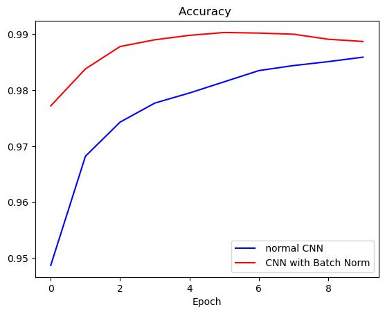<br><sub>Validation accuracy per epoch: regular CNN vs CNN with batch normalisation</sub></td><td width="50%" valign="top">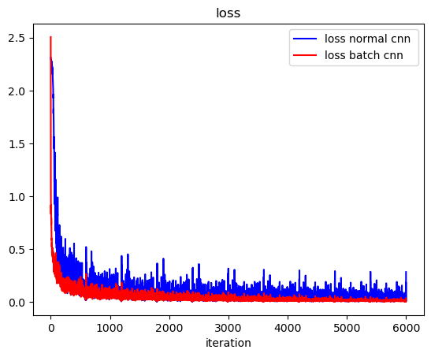<br><sub>Training loss per iteration for both networks</sub></td></tr>
<tr><td width="50%" valign="top">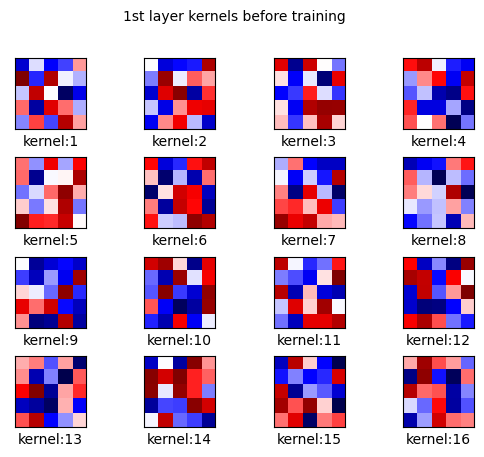<br><sub>First-layer kernels before training</sub></td><td width="50%" valign="top">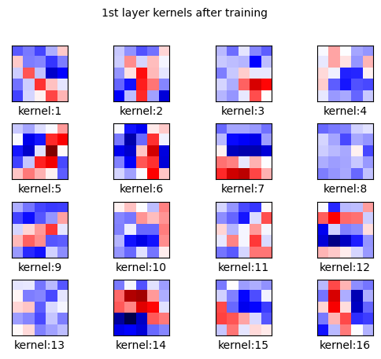<br><sub>First-layer kernels after training</sub></td></tr>
<tr><td width="50%" valign="top">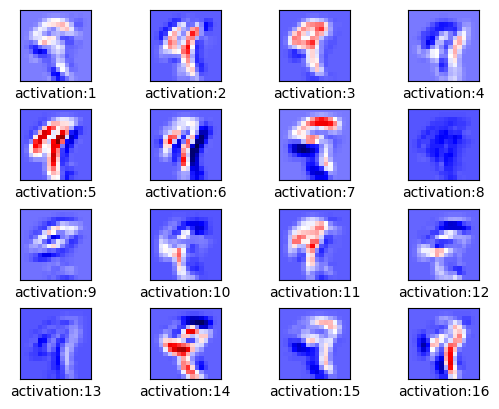<br><sub>Activations after the first convolution</sub></td><td width="50%" valign="top">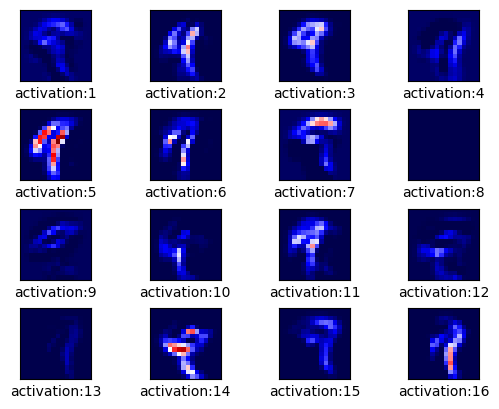<br><sub>Activations after the first ReLU</sub></td></tr>
<tr><td width="50%" valign="top">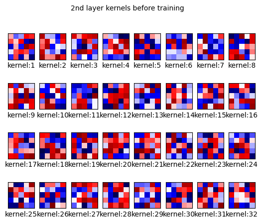<br><sub>Second-layer kernels before training</sub></td><td width="50%" valign="top">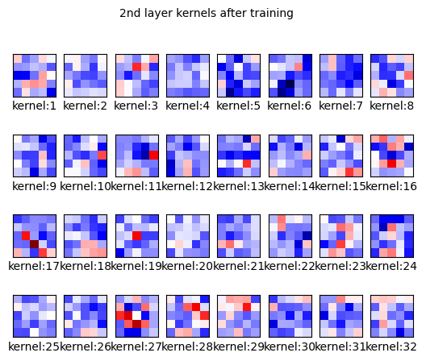<br><sub>Second-layer kernels after training</sub></td></tr>
<tr><td width="50%" valign="top">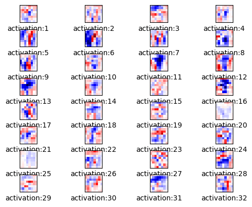<br><sub>Activations after the second convolution</sub></td><td width="50%" valign="top">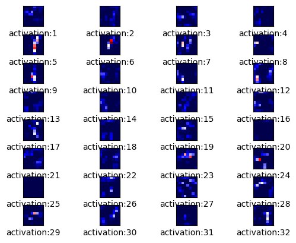<br><sub>Activations after the second ReLU</sub></td></tr>
<tr><td width="50%" valign="top">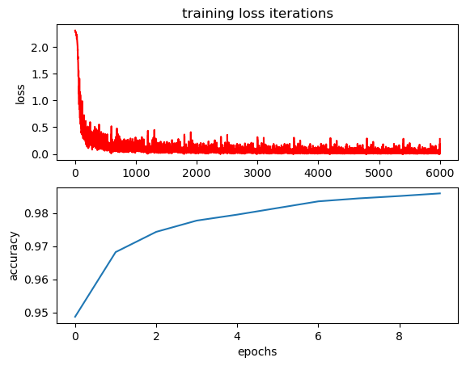<br><sub>Regular CNN: training loss and validation accuracy</sub></td></tr>
</table>

## Run it

1. Download `spec-file.txt`.
2. Follow the instructions in `Conda_Virtual_Env.txt`:

```bash
# a new environment from the spec file
conda create --name myenv --file spec-file.txt
# or install the listed packages into an existing environment
conda install --name myenv --file spec-file.txt
```
The full set of environment commands is in [`Conda_Virtual_Env.txt`](Conda_Virtual_Env.txt).

Then open [`CNN_&_BatchNorm.ipynb`](CNN_%26_BatchNorm.ipynb).

## Built with

`Python` · `PyTorch` · `Matplotlib` · `Torchvision` · `math`

<br>

<p align="center"><sub>Part of the work of <a href="https://github.com/johnnyk1090">Giannis Konteas</a> · end-to-end data science</sub></p>
